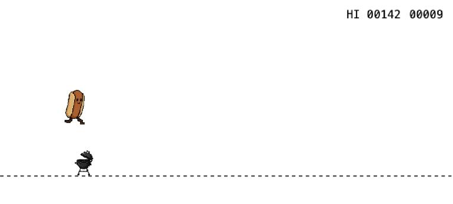

# Hot Dog Run

A one-button endless runner: jump the hot dog over grills and ketchup.



## Embed

```html
<script type="module" src="https://unpkg.com/hot-dog-run"></script>
<hot-dog-run style="width: 800px; height: 360px"></hot-dog-run>
```

Or install it with `npm install hot-dog-run` and use it from JavaScript or React:

```js
import { mount } from 'hot-dog-run';

const game = mount(document.getElementById('game'));
// game.pause(), game.resume(), game.destroy()
```

```jsx
import { HotDogRun } from 'hot-dog-run/react';

<HotDogRun style={{ width: 800, height: 360 }} />
```

The game fills its box, up to 800px wide and 288–360px tall. Space, ↑ or a tap jumps; press again in the air for a boost. P pauses.

### Your own images

Pass image URLs to `mount()` or `<HotDogRun />`. Anything you leave out keeps the default art.

```js
mount(el, {
  player: { run1: 'run1.png', run2: 'run2.png', jump: 'jump.png', dead: 'dead.png' },
  obstacles: [{ src: 'rock.png', height: [30, 60] }],    // regular obstacles
  specials: ['big-rock.png', 'bigger-rock.png'],         // first at 60 points, second at 120, then often after 160
  storageKey: 'my-high-score'
});
```

Other options: `captureKeys` (Space and ↑ don't scroll the page during a run), `pointerTarget` (what listens for taps; default the element) and `active: false` (start paused). Types are in `types/index.d.ts`.

## Develop

```bash
npm install
npm run build              # dist/hot-dog-run.js and dist/react.js
python3 tools/serve.py     # http://localhost:8768 (game) and /demo.html (embeds)
```

- `game.js` is the game, and `sprites.js` holds the default art.
- `npm run sprites` rebuilds `sprites.js` from `sprites/art/`.
- Phaser 3.80.1 (MIT) is bundled into `dist/hot-dog-run.js`.
